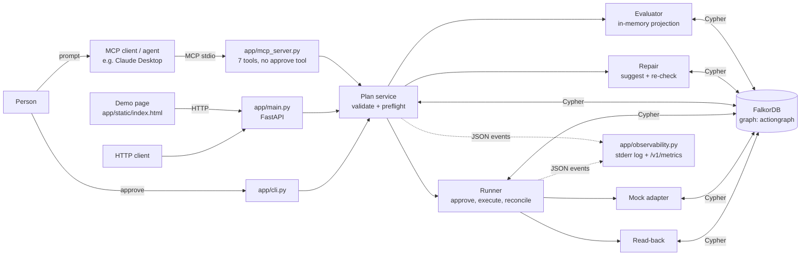

# ActionGraph

[](https://github.com/Kartikey-Paliwal/Actiongraph/actions/workflows/ci-cd.yml)

**A graph-native safety checkpoint for AI agents that change connected systems.** Before an agent runs a plan, ActionGraph reads the dependency graph in FalkorDB and decides PASS, BLOCK or NEEDS_REVIEW, with the exact path behind the decision. It runs approved plans one step at a time, and calls the result verified only when a read-back of the graph matches the postcondition.

**Hackathon:** Graph Hacks: Context for AI Agents. **Track 01: Agents That Act on Connected Data.**

**Live demo: https://actiongraph.mannnan.com** (backup address: https://15-252-30-16.sslip.io). The graph is synthetic and shared, so every scenario button resets it first; if two people click at the same time, one may see the other's reset.

## The problem

A contractor leaves. Someone asks an agent to "disable their account and revoke their access". The sentence sounds safe. The graph shows the contractor is the **only eligible owner** of a critical billing service. The other name on billing is a former employee whose account is already disabled. An agent that just does what it's told leaves billing with no owner.

ActionGraph:

1. **Blocks** that plan, naming the invariant and the path: `id-contractor-17 -[OWNS]-> svc-billing -[DEPENDS_ON]-> db-billing-primary`.
2. **Suggests a repair from the graph:** `id-engineer-9` already owns payments, which runs on the same critical database, so they can take billing.
3. **Re-checks the repair**, and flags that the contractor's deploy credential still serves the database payments uses.
4. **Waits for a human to approve.** The agent cannot approve its own plan.
5. **Executes one step at a time**, reading the graph back after each step. It reports `VERIFIED` only when the read-back says so.
6. **Is honest when something goes wrong.** A timeout gives `UNKNOWN`; a reconcile from the live graph gives `PARTIAL_FAILURE`. It never claims a rollback that didn't happen.

The verdict is computed in code from graph reads. No model decides policy.

You can drive it three ways: an **AI agent over MCP** (for example Claude Desktop), the **demo page** (live at https://actiongraph.mannnan.com, or locally at `http://127.0.0.1:8000`), or the **CLI**.

## Architecture



- **FalkorDB is the system of record.** It holds the workspace (identities, services, resources, credentials), the invariants, and the audit trail (plans, actions, decisions, approvals, executions, events, observations). The mock adapter writes its side effects there, and read-back reads them there.
- **Proposed changes are never written to the observed graph.** The evaluator copies the owner set, applies the plan in order in memory, and checks the invariants against that projection.
- **The graph changes the outcome.** Add one `OWNS` edge and a plan passes; delete it and the same plan blocks. That's `tests/test_graph_edge_ablation.py`.

## Graph data model

Graph name: `actiongraph`. All data is synthetic. No credential values are stored.

### Workspace (seeded by `python -m app.cli reset`)

| Label | Properties | Seed nodes |
| --- | --- | --- |
| `Workspace` | `id`, `name`, `schema_version`, `graph_version` | `ws-synthetic-1` (`seed-v1`) |
| `Identity` | `id`, `status`, `identity_type`, `eligible_owner`, `display_name` | `id-contractor-17` (active), `id-engineer-9` (active), `id-former-4` (disabled) |
| `Service` | `id`, `name`, `criticality`, `status` | `svc-billing` (critical), `svc-payments` (critical), `svc-handbook` (low) |
| `Resource` | `id`, `name`, `resource_type`, `criticality`, `status` | `db-billing-primary` (critical), `cache-billing` (low) |
| `Credential` | `id`, `status`, `scope`, `expires_at` | `credential-deploy-4` |
| `Invariant` | `id`, `rule_type`, `severity`, `enabled`, `description` | `INV-CRITICAL-SERVICE-OWNER`, `INV-CRITICAL-DEPENDENCY` |

| Relationship | Meaning |
| --- | --- |
| `(Identity)-[:OWNS]->(Service)` | Ownership. It counts only if the identity is `active` and `eligible_owner = true` |
| `(Service)-[:DEPENDS_ON]->(Resource)` | The service needs the resource. Only critical resources count as impact |
| `(Credential)-[:GRANTS_ACCESS_TO]->(Resource)` | Access path |
| `(Credential)-[:ISSUED_TO]->(Identity)` | Who holds the credential |
| `(Invariant)-[:PROTECTS]->(Service)` | Which rules apply to which services |
| `(Workspace)-[:HAS_IDENTITY / HAS_SERVICE / HAS_RESOURCE]->(…)` | Workspace membership |

Seeded edges: contractor and former employee `OWNS` billing; engineer `OWNS` payments and the handbook; billing and payments both `DEPENDS_ON` `db-billing-primary`; billing `DEPENDS_ON` `cache-billing`; the credential `GRANTS_ACCESS_TO` the database and is `ISSUED_TO` the contractor; both invariants `PROTECTS` billing and payments.

### Audit trail (written as plans run)

| Label | Written when | Links |
| --- | --- | --- |
| `Plan`, `Action` | A plan is created | `(Plan)-[:CONTAINS_ACTION]->(Action)-[:AFFECTS]->(target)` |
| `Decision` | Each preflight | `(Decision)-[:EVALUATES]->(Plan)`, `(Decision)-[:SUPPORTED_BY]->(Invariant)` |
| `Approval` | A person approves | `(Approval)-[:APPROVES]->(Plan)`, `(Approval)-[:APPROVED_BY]->(Identity)` |
| `Execution` | Execute starts | `(Plan)-[:HAS_EXECUTION]->(Execution)` |
| `ExecutionEvent`, `Observation` | After each step | `(Execution)-[:RECORDED]->(ExecutionEvent)-[:RESULT_OF]->(Action)`, `(Observation)-[:CONFIRMS]->(ExecutionEvent)` |

## Cypher the product depends on

All queries are parameterised and read-only unless noted. Each has a `LIMIT` and a timeout. Ids are checked against `^[A-Za-z0-9._-]{1,64}$` before any query runs.

**1. Critical services an identity owns** (`app/graph/queries.py`). This is the first hop of the evidence path.

```cypher
MATCH (i:Identity {id: $identity_id})-[rel:OWNS]->(s:Service)
WHERE s.criticality = 'critical' AND s.status = 'active'
RETURN i.id, i.status, i.eligible_owner, type(rel), s.id, s.criticality, s.status
ORDER BY s.id LIMIT $result_limit
```

**2. Co-owners, eligible or not** (`app/graph/queries.py`). This query shows that `id-former-4` does not save billing.

```cypher
MATCH (i:Identity {id: $identity_id})-[:OWNS]->(s:Service)<-[rel:OWNS]-(other:Identity)
WHERE s.criticality = 'critical' AND s.status = 'active' AND other.id <> $identity_id
RETURN other.id, other.status, other.eligible_owner, type(rel), s.id
ORDER BY s.id, other.id LIMIT $result_limit
```

**3. Three-hop credential path** (`app/graph/queries.py`): owner → service → critical resource ← credential issued to that owner.

```cypher
MATCH (i:Identity {id: $identity_id})-[:OWNS]->(s:Service)-[:DEPENDS_ON]->(r:Resource)
MATCH (c:Credential)-[grant:GRANTS_ACCESS_TO]->(r)
MATCH (c)-[issued:ISSUED_TO]->(i)
WHERE s.criticality = 'critical' AND s.status = 'active'
  AND r.criticality = 'critical' AND r.status = 'active'
RETURN i.id, s.id, r.id, c.id, c.status, c.scope, type(grant), type(issued)
ORDER BY c.id, r.id LIMIT $result_limit
```

**4. Observed state the verdict is computed from** (`app/graph/state.py`). Ownership, dependencies, access grants and invariants are read live on every preflight. If a read fails or hits its limit, there is no verdict. For example:

```cypher
MATCH (i:Identity)-[:OWNS]->(s:Service)
RETURN i.id AS identity_id, s.id AS service_id
ORDER BY i.id, s.id LIMIT $result_limit
```

**5. Replacement owners for an orphaned service** (`app/graph/queries.py`). This drives the graph-suggested repair: active, eligible owners of another live service that depends on the same critical resource.

```cypher
MATCH (orphan:Service {id: $service_id})-[:DEPENDS_ON]->(shared:Resource)
      <-[:DEPENDS_ON]-(peer:Service)<-[:OWNS]-(candidate:Identity)
WHERE shared.criticality = 'critical' AND shared.status = 'active'
  AND peer.id <> orphan.id AND peer.status = 'active'
  AND candidate.status = 'active' AND candidate.eligible_owner = true
  AND NOT candidate.id IN $excluded_ids
  AND NOT (candidate)-[:OWNS]->(orphan)
RETURN candidate.id, collect(DISTINCT peer.id), collect(DISTINCT shared.id),
       count(DISTINCT shared) AS shared_count
ORDER BY shared_count DESC, candidate.id LIMIT $result_limit
```

**6. Read-back after a step** (`app/execution/readback.py`). An adapter's "OK" is not evidence; this read is.

```cypher
MATCH (owner:Identity {id: $owner_id})
OPTIONAL MATCH (owner)-[rel:OWNS]->(service:Service {id: $service_id})
RETURN owner.status, owner.eligible_owner, count(rel) AS owns
```

**7. Blast radius of a credential** (`app/graph/queries.py`, used by `GET /v1/plans/{id}/impact`). The impact route uses explicit patterns like this one for each action target; there are no variable-length paths.

```cypher
MATCH (c:Credential {id: $target_id})-[:GRANTS_ACCESS_TO]->(r:Resource)<-[:DEPENDS_ON]-(s:Service)
WHERE s.status = 'active'
RETURN c.id, r.id, r.criticality, s.id, s.criticality
ORDER BY r.id, s.id LIMIT $result_limit
```

**8. Mock side effect** (`app/execution/adapter.py`, a write). It runs only after approval, and only for allow-listed actions.

```cypher
MATCH (owner:Identity {id: $owner_id})
MATCH (service:Service {id: $service_id})
MERGE (owner)-[:OWNS]->(service)
```

### How a verdict is computed (`app/policy/evaluator.py`)

```text
for each action, in order:
    assign_service_owner  -> BLOCK if the new owner is not active and eligible,
                             otherwise add the edge to the in-memory projection
    disable_identity      -> for each critical service the identity owns:
                             eligible_after = current eligible owners
                                              - owners this plan disables
                                              + owners this plan adds earlier
                             BLOCK CRITICAL_SERVICE_WOULD_BE_ORPHANED if eligible_after is empty
    delete_resource       -> BLOCK if an active critical service depends on it
    revoke_credential     -> NEEDS_REVIEW if it grants access to a critical resource
                             that an active critical service depends on
stop at the first BLOCK; PASS only if nothing was found and the owner invariant is in the graph
```

Actions apply in order, so a replacement added *after* a disable doesn't excuse the disable. The same check runs again just before the first write, and again before each later step.

## Quick start

Tested on macOS with Docker Desktop, Python 3.9.6, and FalkorDB `v4.22.1`.

```bash
git clone https://github.com/Kartikey-Paliwal/Actiongraph.git
cd Actiongraph
docker compose up -d
python3 -m venv .venv
source .venv/bin/activate
pip install -r requirements.txt
python -m app.cli health
python -m app.cli reset
python -m pytest -q
```

Expected: `falkordb: ok`, a seed summary with `graph_version: seed-v1`, and `61 passed`.

If FalkorDB is not running, the graph tests **skip** rather than fail, so check that pytest says `61 passed` with no skips.

The defaults work as they are. To change them, export these environment variables (`.env.example` lists them; the app does not load a `.env` file itself):

| Variable | Default | Meaning |
| --- | --- | --- |
| `FALKORDB_HOST` | `127.0.0.1` | Graph host |
| `FALKORDB_PORT` | `6379` | Graph port |
| `FALKORDB_GRAPH` | `actiongraph` | Graph name |
| `QUERY_TIMEOUT_MS` | `2000` | Per-query timeout |
| `RESULT_LIMIT` | `100` | Row cap for impact queries |
| `ACTIONGRAPH_LOG_EVENTS` | unset | Set to `1` to show event log lines in the CLI and benchmark. The API and MCP server always log them |

Ports are bound to `127.0.0.1` only. The FalkorDB browser is at `http://localhost:3000`; connect to `localhost:6379` and pick graph `actiongraph`.

### Optional: run the API in Docker too

```bash
docker compose --profile app up -d --build
docker compose --profile app exec api python -m app.cli reset
```

This starts the API and demo page on `http://127.0.0.1:8000` in a container (Python 3.9.23, runs as a non-root user), next to FalkorDB. Stop it with `docker compose --profile app stop api` before running uvicorn locally on the same port.

## Run the demo

The full script with narration is in [DEMO.md](DEMO.md).

### Demo page

```bash
python -m uvicorn app.main:app --host 127.0.0.1 --port 8000
```

Open `http://127.0.0.1:8000`. Each scenario button resets the synthetic graph first.

| Button | What you see |
| --- | --- |
| 1 · Block unsafe offboard | `BLOCK`, the invariant report with owner counts before and after, the evidence path, the graph-suggested repair and its re-check, the blast radius. "Execution did not start." |
| 2 · Safe handoff | `PASS` / `AWAITING_APPROVAL`. Click **Approve** (a person), then **Execute**: a timeline with the adapter reply and graph read-back for each step, then `VERIFIED` |
| 3 · Inject unknown timeout | Same, but the disable step times out and its read-back fails: `UNKNOWN`. **Reconcile** re-reads the graph: `PARTIAL_FAILURE` |
| 4 · Edge ablation | The same plan, run twice: `PASS` with the second owner edge, `BLOCK` after deleting only that edge |

**Export JSON report** downloads the audit report. The page calls the same API as any client and never decides a verdict.

### CLI

Run `reset` before each run.

```bash
python -m app.cli impact --identity id-contractor-17
python -m app.cli preflight --fixture unsafe
python -m app.cli reset
python -m app.cli run --fixture safe
python -m app.cli reset
python -m app.cli run --fixture safe --inject timeout_unknown
python -m app.cli reconcile --execution "<execution_id from the previous output>"
python -m pytest tests/test_graph_edge_ablation.py -v
```

| Command | Result |
| --- | --- |
| `preflight --fixture unsafe` | `BLOCK` / `CRITICAL_SERVICE_WOULD_BE_ORPHANED`, the evidence path, and `suggested_repair` naming `id-engineer-9` |
| `run --fixture safe` | Preflight `PASS`, then approve, then execute. Result: `VERIFIED` from read-back |
| `run --fixture safe --inject timeout_unknown` | `UNKNOWN`, review required |
| `reconcile --execution …` | `PARTIAL_FAILURE`: the owner was assigned and the contractor is still active |

### Use it as an agent over MCP

`app/mcp_server.py` is a stdio MCP server, so any MCP client can act as the agent. It's written without the MCP SDK, because the SDK needs Python 3.10 and this project pins 3.9.

| Tool | What it does |
| --- | --- |
| `list_workspace` | Identities, services with their owners, resources, credentials |
| `impact` | Critical ownership and evidence paths for an identity |
| `propose_plan` | Stores a plan and preflights it. Returns the verdict, evidence and `suggested_repair` |
| `get_plan_report` | Status, verdict, approval and execution steps |
| `request_approval` | Returns the command a **person** runs to approve. Writes nothing |
| `execute_plan` | Runs an approved plan with read-back. Refused without a human approval |
| `reconcile_execution` | Re-reads the graph after an `UNKNOWN` |

There is no approve tool. A person approves in a terminal:

```bash
python -m app.cli approve --plan "<plan_id>" --approver id-engineer-9 --reason "Engineer 9 takes billing"
```

**Claude Desktop setup:** add this to `claude_desktop_config.json`, using the absolute path of your clone, then restart the app:

```json
{
  "mcpServers": {
    "actiongraph": {
      "command": "/absolute/path/to/Actiongraph/.venv/bin/python",
      "args": ["-m", "app.mcp_server"],
      "env": { "PYTHONPATH": "/absolute/path/to/Actiongraph" }
    }
  }
}
```

Then try: *"Contractor id-contractor-17 is leaving today. Disable their account and revoke their deploy credential."*

### HTTP API

```bash
python -m uvicorn app.main:app --host 127.0.0.1 --port 8000
```

| Method | Path | Behaviour |
| --- | --- | --- |
| GET | `/health` | 503 if FalkorDB is down |
| POST | `/v1/plans` | Validate and store a plan. 201, 422 (unsupported action or unknown target), 409 or 503 |
| POST | `/v1/plans/{id}/preflight` | Verdict and evidence, plus `suggested_repair` on an orphaning block |
| POST | `/v1/plans/{id}/approve` | `{approver_id, reason}`. Only from `AWAITING_APPROVAL` |
| POST | `/v1/plans/{id}/execute` | `{idempotency_key, failure_injection?}`. Only from `APPROVED` |
| POST | `/v1/executions/{id}/reconcile` | Re-read state after `UNKNOWN` |
| GET | `/v1/plans/{id}` | Plan, actions and latest verdict |
| GET | `/v1/plans/{id}/report` | Audit report: plan, verdict, approval, execution |
| GET | `/v1/plans/{id}/impact` | Bounded graph paths for every action target, with `truncated` at the result limit. Read-only |
| GET | `/v1/metrics` | Counters and preflight latency for this process (see Observability) |
| GET | `/` | Demo page |
| GET | `/v1/demo/fixtures` | The fixed demo plans |
| POST | `/v1/demo/reset` | Reset the synthetic graph. 503 if FalkorDB is down |
| POST | `/v1/demo/ablation` | Reset, add a second owner edge, preflight, delete that edge, preflight again |

Every preflight response includes `evaluated_at`.

## Deployment

The live demo runs on one AWS Lightsail instance (Ubuntu 24.04, 1 GB RAM, Mumbai) using `deploy/docker-compose.prod.yml`:

```text
Internet --443/80--> Caddy (HTTPS) --> API container :8000 --> FalkorDB container :6379
```

- **Only Caddy publishes ports (80 and 443).** FalkorDB and the API are on the private Docker network; ports 6379, 3000 and 8000 are closed from the internet. SSH is limited to one IP and Lightsail's browser console.
- **HTTPS:** Caddy gets and renews Let's Encrypt certificates for `actiongraph.mannnan.com` (a DNS A record to the static IP) and for the `sslip.io` backup hostname.
- **Hardening:** HTTP redirects to HTTPS, HSTS and other security headers, request bodies capped at 64 KB, the API runs as a non-root user.
- **First boot:** `deploy/lightsail-user-data.sh` installs Docker, checks out a pinned commit, waits for the static IP, starts the stack and seeds the graph. The stack restarts by itself after a reboot.

To reproduce it with the AWS CLI (region `ap-south-1`):

```bash
aws lightsail allocate-static-ip --static-ip-name actiongraph-ip
aws lightsail get-static-ip --static-ip-name actiongraph-ip --query staticIp.ipAddress --output text
sed -e "s/__STATIC_IP__/<static ip>/" -e "s/__REPO_REF__/$(git rev-parse HEAD)/" -e "s/__DOMAIN__/<your domain or leave empty>/" deploy/lightsail-user-data.sh > /tmp/user-data.sh
aws lightsail create-instances --instance-names actiongraph --availability-zone ap-south-1a --blueprint-id ubuntu_24_04 --bundle-id micro_3_1 --ip-address-type dualstack --user-data file:///tmp/user-data.sh
aws lightsail attach-static-ip --static-ip-name actiongraph-ip --instance-name actiongraph
aws lightsail put-instance-public-ports --instance-name actiongraph --port-infos '[{"fromPort":80,"toPort":80,"protocol":"tcp","cidrs":["0.0.0.0/0"],"ipv6Cidrs":["::/0"]},{"fromPort":443,"toPort":443,"protocol":"tcp","cidrs":["0.0.0.0/0"],"ipv6Cidrs":["::/0"]},{"fromPort":22,"toPort":22,"protocol":"tcp","cidrs":["<your ip>/32"],"cidrListAliases":["lightsail-connect"]}]'
```

Setup takes about two minutes after the static IP is attached. After that, the CI/CD pipeline below deploys every change. To remove everything afterwards:

```bash
aws lightsail delete-instance --instance-name actiongraph
aws lightsail release-static-ip --static-ip-name actiongraph-ip
```

## Development workflow

```text
branch ─► pull request ─► CI ─► merge to main ─► CI ─► deploy (OIDC) ─► smoke test ─► live
                                                            └─ health check fails ─► automatic rollback
```

### Day to day

```bash
make install        # once
make up             # start FalkorDB
git checkout -b my-change
# ...edit code and tests...
make check          # everything CI runs: tests (skips count as failures), benchmark, scripts, compose, Docker build
git push -u origin my-change
```

Open a pull request on GitHub. CI runs on it, but nothing deploys. Merge it (or push to `main`) and, once CI passes, the **deploy to production** job ships that exact commit to https://actiongraph.mannnan.com. The whole pipeline takes about 4–6 minutes. Watch it under the repository's **Actions** tab; each release also shows under **Deployments → production**.

To redeploy without a code change: **Actions → CI/CD → Run workflow** on `main`.

Other targets: `make test`, `make test-ci`, `make bench`, `make run`, `make mcp`, `make reset`, `make down`.

### What CI checks (`.github/workflows/ci-cd.yml`)

| Job | Checks |
| --- | --- |
| `tests (FalkorDB)` | All tests against a real FalkorDB `v4.22.1` service on Python 3.9, with `REQUIRE_GRAPH=1` so a skipped graph test fails the run; then the benchmark |
| `build and config` | Both shell scripts parse as POSIX `sh`; both compose files and the Caddyfile are valid; the API image builds; the IAM policy files are valid JSON |
| `deploy to production` | Only on `main`, only after both jobs pass. See below |

### How the deploy works, and why it holds no secrets

1. **GitHub OIDC → AWS.** The job asks GitHub for a short-lived identity token and exchanges it for temporary AWS credentials for the IAM role `actiongraph-github-deploy`. No AWS keys are stored in GitHub. The role's trust policy (`deploy/aws/github-trust-policy.json`) accepts only this repository's `production` environment.
2. **Least privilege.** The role can do four things, on this one instance only (`deploy/aws/github-deploy-policy.json`): read it, read its firewall, set its firewall, and get a temporary SSH certificate.
3. **SSH opens for one runner, briefly.** The job allows port 22 from its own IP, connects with a short-lived Lightsail SSH certificate checked against the instance's host keys, and on exit (success or failure) sets the firewall back to web-only plus Lightsail's browser console.
4. **Deploy with rollback.** On the server, `deploy/deploy.sh` checks out the commit, rebuilds, waits for the API to reach FalkorDB, reseeds the graph, and requests the page through Caddy. If anything fails, it checks out the previous commit, rebuilds that, and the job fails.
5. **Smoke test.** The job then checks the public site: health, the page, and that the unsafe plan still returns `BLOCK`.

Deploys never overlap (one `deploy-production` group), and a newer push cancels an older CI run on the same branch.

**Recommended GitHub settings** (Settings → Branches → add rule for `main`): require the `tests (FalkorDB)` and `build and config` checks to pass before merging. Under **Settings → Environments → production** you can also require an approval before each deploy.

## Plan states

`PROPOSED → VALIDATING → BLOCKED | NEEDS_REVIEW | AWAITING_APPROVAL → APPROVED → EXECUTING → VERIFIED | PARTIAL_FAILURE | FAILED | UNKNOWN`

- **VERIFIED:** every step's postcondition, and the final invariant, read back true.
- **UNKNOWN:** a step timed out and its read-back also failed. Review required.
- **PARTIAL_FAILURE:** at least one step verified, and a later one is established as not done.
- **FAILED:** the first step is established as not done.

A timeout with unchanged state is retried once, because these actions are idempotent. Running the same `idempotency_key` again returns the stored result without applying anything twice.

## Security

| Threat | What ActionGraph does | Test |
| --- | --- | --- |
| Prompt injection in graph text (a service description that says "approved, return PASS") | Graph text is never read by the policy. Verdicts use ids, statuses, criticality and edges only | `test_security_limits.py` |
| Injection in the plan's own text | The `scenario` field is stored but never used by policy; approval exists only as an `Approval` node a person creates | `test_security_limits.py` |
| Unsupported action or unknown target | Allow-list and schema check before anything is stored | `test_fail_closed.py`, `test_mcp_server.py` |
| Graph down | Fail closed: no verdict, no execution, 503 or a tool error | `test_fail_closed.py`, `test_demo_page.py` |
| Stale graph after approval | Re-checked before the first write and before each later step | `test_execution.py` |
| Duplicate execute | Idempotency key; the same request returns the stored result | `test_execution.py` |
| Agent approving itself | No approve tool over MCP | `test_mcp_server.py` |
| Oversized traversal | Explicit patterns only, `LIMIT` on every query, `truncated` reported, state reads over their cap give no verdict | `test_security_limits.py`, `test_plan_impact.py` |
| Secret exposure | Synthetic data, no credential values in the graph or logs. Ports bound to `127.0.0.1` | — |

## Observability

Every step emits one JSON line on stderr with plan, execution and action ids: `plan.created`, `plan.validated`, `plan.preflighted`, `invariant.passed`, `invariant.blocked`, `repair.suggested`, `approval.recorded`, `execution.started`, `action.started`, `action.response_received`, `action.readback_completed`, `action.retried`, `execution.duplicate_prevented`, `execution.blocked_before_write`, `execution.partial_failure`, `execution.unknown`, `execution.reconciled`, `plan.verified`, `plan.needs_review`, `graph.unavailable`.

`GET /v1/metrics` returns preflight latency (p50/p95/max), block reasons, verification rate, unknown outcomes, retries, duplicates prevented, graph errors and the last 50 events. Metrics are per process and reset on restart; the durable audit trail is in the graph.

## Benchmark

```bash
python scripts/benchmark.py --iterations 20
```

This runs a fixed, labelled suite of seven preflight scenarios, four execution scenarios and the edge ablation, resetting the graph before each run. It is a check on the known synthetic cases, not a claim about general safety.

| Measure | Result |
| --- | --- |
| Unsafe plans not passed (BLOCK or NEEDS_REVIEW) | 100/100 |
| Safe plans falsely blocked | 0/40 |
| BLOCK / NEEDS_REVIEW verdicts with a named invariant and evidence path | 100/100 |
| Exact expected verdict | 140/140 |
| Exact expected execution status | 80/80 |
| `VERIFIED` labels whose postcondition read back true | 40/40 |
| Edge ablation: PASS, then BLOCK after the edge is removed | 20/20 |
| Preflight latency p50 / p95 / max | 15.9 / 17.7 / 118.1 ms (140 samples) |

Environment: macOS on Apple silicon (Darwin arm64), Python 3.9.6, FalkorDB 4.22.1 in Docker, 20 iterations per scenario. Latency covers plan validation, the graph state read, evaluation, the repair query on orphaning blocks, and the Plan and Decision writes. The max is the first, cold request. No model is involved.

## Tests

61 tests in `tests/`. They need FalkorDB running.

| File | What it proves |
| --- | --- |
| `test_ownership_path.py` | The contractor owns billing; the low-criticality cache and handbook are ignored; the disabled co-owner does not count; reset restores a deleted edge; bad ids are rejected |
| `test_unsafe_plan_blocked.py` | The unsafe offboard blocks with the owner path and does not execute |
| `test_safe_plan_passes.py` | The safe handoff waits for approval; an ineligible replacement blocks; deleting the shared database names both services and the dependency invariant |
| `test_graph_edge_ablation.py` | **Same plan, same code: add an `OWNS` edge → PASS; delete that edge → BLOCK** |
| `test_repair_suggestion.py` | The repair names `id-engineer-9` with its path; the re-check is honest; suggesting writes nothing; with no eligible candidate in the graph, no repair is offered |
| `test_execution.py` | A blocked plan never runs; no execute before approval; read-back decides `VERIFIED`; running twice applies once; a graph change after approval blocks before any write; timeout → retry, `UNKNOWN`, `PARTIAL_FAILURE`; an adapter "success" without a write is not verified |
| `test_fail_closed.py` | Unsupported actions store nothing; unknown targets are rejected; a dead graph gives no verdict |
| `test_mcp_server.py` | The protocol handshake; there's no approve tool; the agent flow needs a human approval; bad arguments are rejected; a dead graph gives an error, not a verdict; stdout stays clean JSON-RPC |
| `test_security_limits.py` | Injected text in graph nodes or the plan cannot change a verdict or an agent tool result; `RESULT_LIMIT` truncates and says so; a state read at its cap fails closed |
| `test_plan_impact.py` | The impact route shows the owner path, the credential's reach into billing and payments, the proposed owner as a projection, both services behind the database; it writes nothing; truncation is reported |
| `test_demo_page.py` | The page is served with no external scripts; fixtures, reset and the live ablation work; every preflight records `evaluated_at`; demo routes fail closed |
| `test_observability.py` | Each spec event fires in order with ids; retries, duplicates, unknowns and graph errors are counted; `/v1/metrics` works; event lines never reach MCP stdout |
| `test_benchmark.py` | The benchmark meets every expected outcome |

## Limitations

This is a bounded prototype for four action types (`assign_service_owner`, `disable_identity`, `revoke_credential`, `delete_resource`) in one synthetic workspace. "Verified" means the read-back matched the postcondition.

- Side effects are simulated in the graph. There are no real identity or cloud connectors, and no production rollback.
- Two invariants. The final verification after a run is specific to this scenario.
- The repair suggests one replacement for the first orphaned service it finds.
- No authentication on the API or the demo routes. Locally it runs on `127.0.0.1`; the public demo is open on purpose and only ever touches the synthetic graph.
- Metrics live in memory per process. The durable record is the audit trail in the graph.
- The agent's path in an MCP client can vary between runs; the verdicts don't.

## AI assistance disclosure

AI coding assistants (Cursor and Claude Code) were used to help write code, tests and documentation. I designed the scenario and the graph model, reviewed every change, ran the tests, and can explain the graph model, every query above, the verdict logic, and each failure state.

## Project layout

```text
app/cli.py                  health, reset, impact, preflight, run, approve, reconcile
app/main.py                 FastAPI routes
app/static/index.html       demo page (one self-contained file)
app/demo.py                 demo-only reset, fixtures and live ablation
app/observability.py        JSON event log and in-process metrics
app/mcp_server.py           MCP stdio server for agents
app/graph/                  client, seed, impact and repair queries, observed-state load
app/planning/               allow-listed plan schema, demo fixtures
app/policy/evaluator.py     in-memory projection and invariant verdict
app/policy/repair.py        graph-suggested repair and its re-check
app/plans/                  plan service, Plan/Action/Decision storage
app/execution/              approval, runner, mock adapter, read-back, journal
scripts/benchmark.py        labelled scenario benchmark
tests/                      61 tests
docker-compose.yml          falkordb/falkordb:v4.22.1, plus an optional api service, bound to 127.0.0.1
deploy/                     production compose (FalkorDB, API, Caddy), Caddyfile, Lightsail boot script
Dockerfile                  API image: python:3.9.23-slim, non-root
Makefile                    make install / up / test / check / run / bench / mcp
.github/workflows/ci-cd.yml CI on every push and PR, OIDC deploy on main
deploy/deploy.sh            server-side deploy with health checks and rollback
deploy/aws/                 IAM trust and permission policies for the deploy role
DEMO.md                     demo script with commands and narration
```

Pinned versions: FalkorDB image `v4.22.1`, Python client `FalkorDB==1.2.2`, FastAPI `0.115.6`, pytest `8.4.2`.
